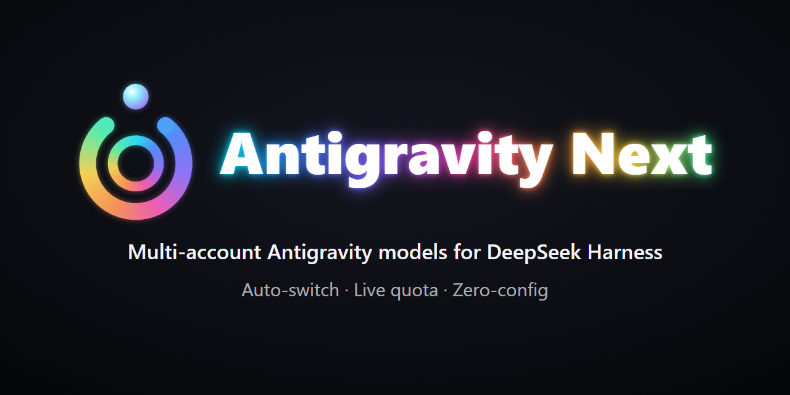

# Antigravity Next for DSH

<p align="center">
  
</p>

[](https://github.com/kizaki-R/Antigravity-Next-for-DSH/actions/workflows/ci.yml)
[](package.json)
[](LICENSE)
[](https://deepseek.com/harness/)

[English](README.md) | [繁體中文](README.zh-TW.md) | [简体中文](README.zh-CN.md)

An unofficial model provider plugin for [DeepSeek Harness](https://deepseek.com/harness/) (DSH). It connects locally installed Google Antigravity / Cloud Code Assist models directly to your DSH agent loop under provider id `agy-next`.

> **Disclaimer:** Unofficial integration. Not affiliated with, endorsed by, or officially supported by Google or DeepSeek. Requires an authorized Google account and a local installation of the official Antigravity application.

---

## Highlights

- **Zero Cloud Console Setup:** Resolves OAuth client pairs directly from your local Antigravity installation. No need to create a project or credentials in Google Cloud Console.
- **Multi-Account Pooling:** Add multiple Google accounts with quota thresholds. When one account runs out, the plugin automatically switches to a standby account.
- **Quota Telemetry:** Live quota progress bars for Gemini, Claude, and Gemini 4 Argon (5-hour and weekly windows) directly in the Settings panel.
- **Reasoning Effort Control:** Direct mapping for reasoning efforts (Low, Medium, High) across Gemini 4 Argon, Gemini 3.8 Flash, and Claude models.
- **Local Credential Storage:** Discovery is read-only. Tokens stay in `<DSH_HOME>/storages/agy-next-oauth.json` and are never uploaded.

---

## Requirements

1. **DeepSeek Harness:** `>=0.1.5-rc.1 <0.3.0` running on Node `>=20`.
2. **Official Antigravity App:** Installed locally on Windows or macOS (Linux support in progress). Download from the [official portal](https://antigravity.google/product/antigravity-2). *The application does not need to be running.*
3. **Google Account:** With browser consent capability and access to Gemini / Cloud Code Assist models.

---

## Installation

### Method 1: DSH UI (Recommended)

1. Open **Plugins → + Add plugin** in the DSH sidebar.
2. Enter the repository URL:
   ```text
   https://github.com/kizaki-R/Antigravity-Next-for-DSH
   ```
   *(Or enter `agy-next` once published to npm).*
3. Select **Install**, then restart DSH.

### Method 2: Local Developer Link (CLI)

For local development:

```bash
dsh plugin --profile <profile> add link:/absolute/path/to/agy-next
```

Make sure `agy-next` is in your profile's `dsh.profile.bundles`, then restart DSH.

---

## Getting Started

### 1. Account Setup

In DSH, open **Settings → AGY-Next**:

1. **Check Status:** Confirm DSH detects the local Antigravity installation path.
2. **Add Account:** Click **Sign in / Add account**. A browser window opens for standard Google OAuth consent.
3. Once authenticated, the account appears in the Account Pool with real-time quota bars.

*CLI commands:*

```bash
npm run login              # Sign in account
npm run login -- --status  # Check active account & quota
npm run login -- --force   # Force re-authentication
npm run login -- --logout  # Clear stored credentials
```

### 2. Custom Installation Path

If Antigravity is installed in a non-standard location, set the environment variable before starting DSH:

```powershell
# PowerShell
$env:AGY_NEXT_INSTALL_PATH = 'C:\Custom\Path\To\Antigravity'
```

---

## Configuration

Custom parameters can be set in your profile's `cordis.yml`:

```yaml
- id: agy-next
  name: agy-next
  config:
    credentialPath: ""               # Default: <DSH_HOME>/storages/agy-next-oauth.json
    streamIdleTimeoutMs: 300000      # Idle stream protection timeout (ms, default 5 mins)
    discoveryTimeoutMs: 8000         # Local client discovery timeout (ms)
    projectCacheTtlMs: 1800000       # Project metadata cache TTL (ms, 30 mins)
    runtimeModel: ""                 # Optional: pin a specific upstream model id
```

---

## Supported Models

| Model Family | Key Models | Context Window | Key Capabilities |
|---|---|---|---|
| **Gemini 4 Argon** | `gemini-4-argon` | 1M tokens | Low / Medium / High reasoning efforts, 5h & weekly quota telemetry |
| **Gemini 3 / 2.5** | `gemini-3.8-flash`, `gemini-3-flash`, `gemini-2.5-pro`, `gemini-2.5-flash` | 1M tokens | High-speed multimodal streaming, tool calling |
| **Claude** | `claude-sonnet-5-5`, `claude-opus-5-5`, `claude-opus-4-6`, `claude-sonnet-4-6` | 1M tokens | Deep integration with Cloud Code Assist Claude runtime |
| **Open Source** | `gpt-oss-120b` | 128k tokens | High-parameter open-weights inference |

---

## Development

Run offline tests inside `agy-next/`:

```bash
npm run check        # Syntax validation across all 40 modules
npm test             # Offline regression suite (21 fixture tests)
npm run test:peers   # Strict host peer contract test (requires AGY_PEER_ROOT)
```

To run peer contract tests, export the DSH runtime dependency path:

```powershell
$env:AGY_PEER_ROOT = 'C:\path\to\dsh\node_modules'
npm run test:peers
```

---

## Security

- **No Hardcoded Secrets:** The repository contains no Google Client IDs or Client Secrets. Values are resolved dynamically at runtime from local application resources.
- **Storage Isolation:** Credentials are saved to `agy-next-oauth.json` under the DSH home directory. The official Antigravity app database is never read or modified.
- **Tombstone Cleanup:** Signing out writes an empty book with `loggedOut: true` to prevent automatic re-import from legacy configurations.

---

## License

[MIT](LICENSE) © [Kizaki](https://github.com/kizaki-R)
