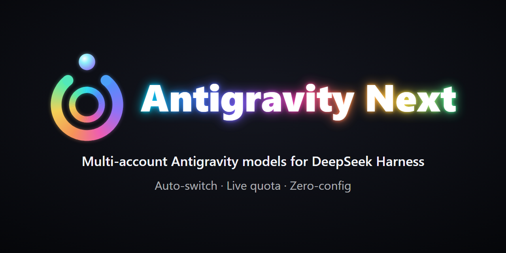
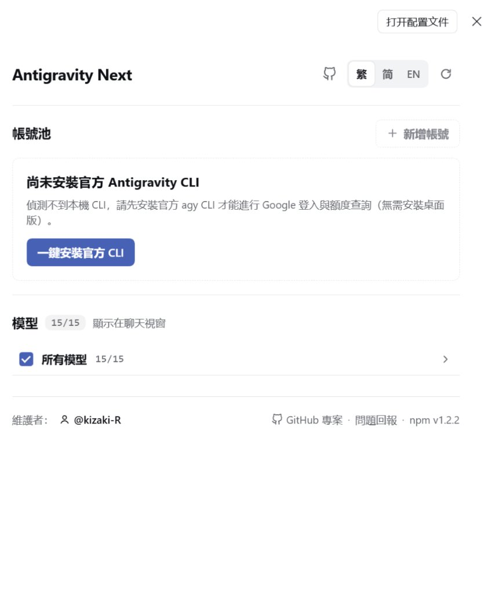
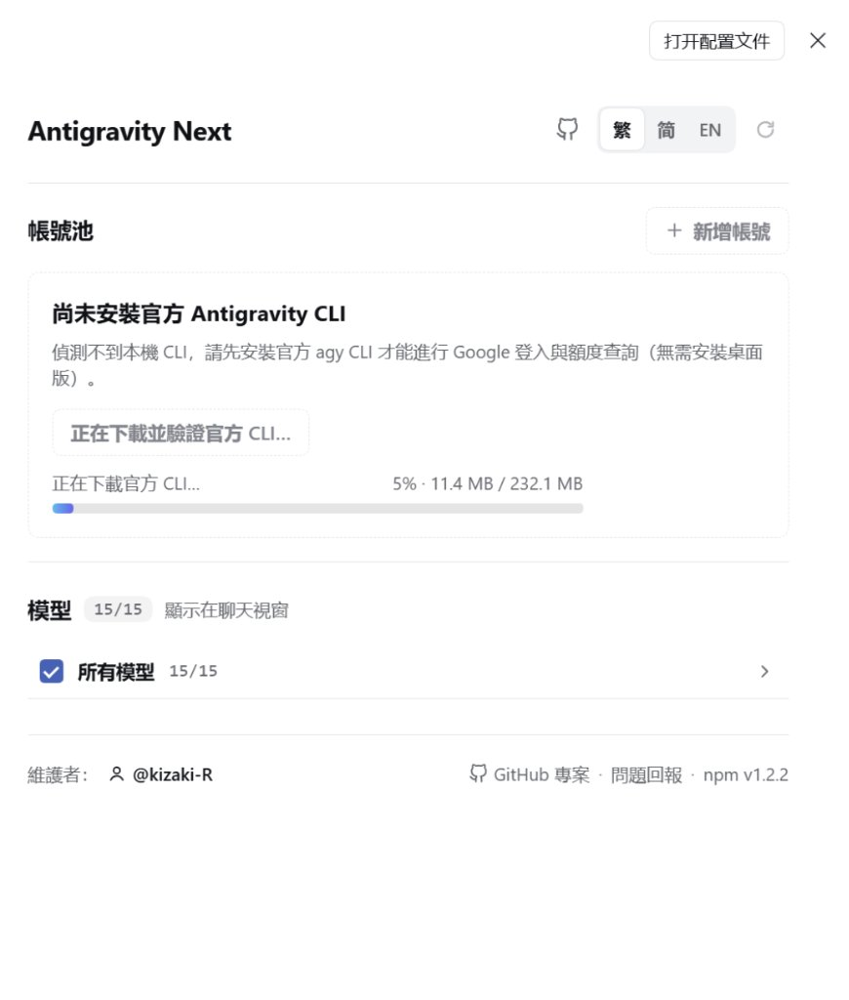
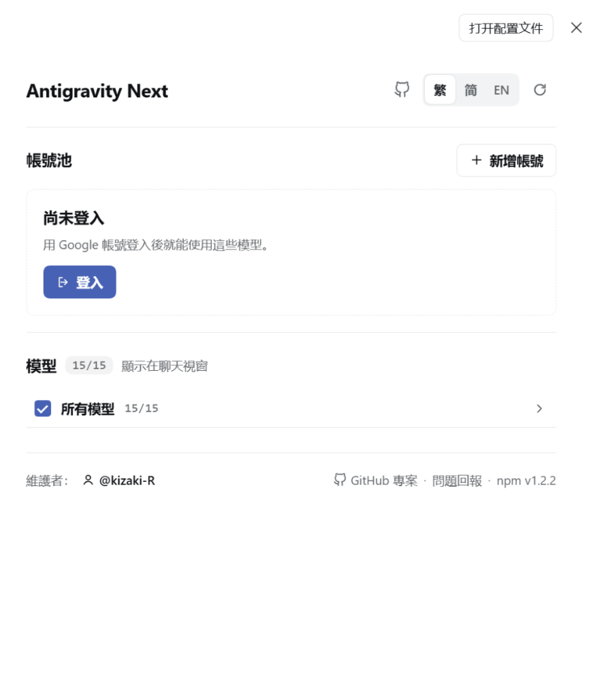

# Antigravity Next for DSH

<p align="center">
  
</p>

[](https://github.com/kizaki-R/Antigravity-Next-for-DSH/actions/workflows/ci.yml)
[](https://www.npmjs.com/package/agy-next)
[](LICENSE)
[](https://deepseek.com/harness/)

English | [繁體中文](README.zh-TW.md) | [简体中文](README.zh-CN.md)

A Google Antigravity provider plugin for [DeepSeek Harness](https://deepseek.com/harness/) (DSH), registered under provider id `agy-next`.

Starting with `v2.0.0`, `agy-next` communicates through Google's official **Antigravity ACP (`agy acp` / `agy_acp_server`)** runtime instead of inspecting local desktop/IDE binaries or making direct Cloud Code REST requests. No pre-installed Antigravity desktop app is required: you can install the official CLI inside DSH Settings, sign in with Google, inspect live quota windows, use DSH tools, and send multimodal image prompts.

> **Disclaimer:** Unofficial community integration, not affiliated with, endorsed by, or officially supported by Google or DeepSeek. Authentication runs through Google's official Antigravity CLI with your own account.

---

## What Changed in v2.0.0

- **Official ACP runtime over stdio JSON-RPC:** `AntigravityAcpAdapter` launches `agy acp` (or `agy_acp_server`) instead of parsing `resources/app.asar` / IDE `main.js` for OAuth secrets.
- **Zero-preinstall CLI onboarding:** If no local `agy` binary is found, Settings provides a one-click installer that downloads Google's official release into `<DSH_HOME>/runtimes/agy-next` with `storage.googleapis.com` origin checks, SHA-512 verification, and a live progress bar (`%` and `MB / MB`).
- **Native keyring & CLI token reading:** Reads the active OAuth token from Windows Credential Manager, macOS Keychain, Linux Secret Service (`gemini:antigravity`), or `GEMINI_HOME` token files to display your Google email, subscription tier, and 5-hour/weekly quota bars with silent refresh.
- **DSH MCP tool & approval bridge:** Exposes DSH `ToolRuntime` tools to ACP sessions via an authenticated loopback MCP stdio bridge (`bin/acp-mcp-stdio.mjs`), with Draft 2020-12 JSON Schema normalization and DSH approval modal routing.
- **Multimodal image input & reasoning effort:** Resolves DSH image attachments via `attachments.readImageRequest` into ACP image blocks, maps `reasoningEffort` to ACP `thought_level`, and closes ephemeral sessions cleanly with `session/close`.

---

## Settings Preview

<table>
  <tr>
    <td align="center" width="33%">
      <br />
      <sub>1. Prompt to install official CLI when none is detected</sub>
    </td>
    <td align="center" width="33%">
      <br />
      <sub>2. Live download &amp; SHA-512 verification progress</sub>
    </td>
    <td align="center" width="33%">
      <br />
      <sub>3. CLI ready for Google OAuth sign-in</sub>
    </td>
  </tr>
</table>

---

## Requirements

- **Node.js:** `>= 20`
- **DeepSeek Harness:** `0.1.5-rc.1` – `0.2.x`
- **Platforms:** Windows, macOS, and Linux (`x64` / `arm64`, including Linux musl detection)
- **Google Account:** Standard Google account authorized for Antigravity via browser OAuth

---

## Installation

### Method 1: DSH Marketplace (Recommended)

1. Open **Plugins → Marketplace** in DSH.
2. Search for `agy-next` or `antigravity`.
3. Click **Install**, then reload or restart DSH.

### Method 2: npm CLI

Install inside your DSH profile directory:

```bash
cd ~/.dsh/profiles/desktop
npm install agy-next@2.0.0
```

### Method 3: Local Link (Development)

```bash
dsh plugin --profile <profile> add link:/absolute/path/to/agy-next
```

---

## Quick Start

1. Open **Settings → AGY-Next** in DSH.
2. If no local CLI is detected, click **Install official CLI** and wait for download and SHA-512 verification to complete.
3. Click **Sign in** and complete Google OAuth in your browser.
4. Confirm your email, tier badge, and quota bars appear, then pick any model under **Antigravity Next** in chat.

> Upgrading from `v1.x`? Tokens stored under the legacy REST/ASAR flow cannot refresh under ACP. Sign in again in **Settings → AGY-Next** after updating.

CLI helper commands (from the `agy-next` package directory):

```bash
npm run login -- --check-install   # Check ACP binary availability
npm run login                      # Install CLI if needed and sign in
npm run login -- --status          # Inspect auth status and email
npm run login -- --force           # Re-authenticate with Google
npm run login -- --logout          # Sign out of Antigravity ACP
```

See [SETUP.md](SETUP.md) for full details and troubleshooting.

---

## CLI Discovery & Configuration

`resolveAcpLaunch()` checks for an ACP binary in this order:

1. `AGY_NEXT_ACP_BIN` (explicit path override)
2. `agy` on `PATH` (invoked as `agy acp`)
3. `agy_acp_server` on `PATH`
4. Per-user default install locations (`%LOCALAPPDATA%\agy\bin\agy.exe` on Windows; `~/.local/bin/agy`, `~/.local/bin/antigravity`, `~/.agy/bin/agy` on macOS/Linux)
5. Plugin-managed CLI under `<DSH_HOME>/runtimes/agy-next`

Active configuration keys (`cordis.yml` / environment variables):

| Config Key | Environment Variable | Description |
|---|---|---|
| `credentialPath` | `AGY_NEXT_CREDENTIAL_PATH` | Account metadata & visibility ledger path (default `<DSH_HOME>/storages/agy-next-oauth.json`) |
| — | `AGY_NEXT_ACP_BIN` | Override path to a custom `agy` binary |

Legacy `v1.x` keys (`clientSource`, `discoveryTimeoutMs`, `projectCacheTtlMs`, `clientId`, `clientSecret`, `clientPath`, `AGY_NEXT_INSTALL_PATH`) are retired and ignored in `v2.0.0`.

---

## Supported Models

The built-in catalog provides defaults and updates dynamically from ACP `session/new` capabilities:

| Family | Representative Models | Context Window | Notes |
|---|---|---|---|
| **Gemini 4 Argon** | `gemini-4-argon` | 1M tokens | `low` / `medium` / `high` `thought_level`, multimodal image input |
| **Gemini 3 / 2.5** | `gemini-3.8-flash`, `gemini-3-flash`, `gemini-3.1-flash-lite`, `gemini-2.5-pro`, `gemini-2.5-flash` | 1M tokens | Multimodal streaming, tool calling via MCP bridge |
| **Claude** | `claude-sonnet-5-5`, `claude-opus-5-5`, `claude-opus-4-6`, `claude-sonnet-4-6` | 250k – 1M tokens | Runs through Antigravity ACP with `thought_level` support |
| **Open Source** | `gpt-oss-120b` | 128k tokens | Served through Antigravity ACP |

---

## Development & Offline Verification

```bash
npm run check          # Syntax-check all 55 modules + UI version guard
npm test               # Run all 10 offline regression and ACP test suites
npm run test:peers     # Run regression tests against linked DSH peer packages
npm run verify:peers   # Run offline peer contract checks
```

Export `AGY_PEER_ROOT` when running peer contract tests locally:

```powershell
$env:AGY_PEER_ROOT = 'C:\path\to\dsh\node_modules'
npm run test:peers
```

---

## Security & Privacy

- **No bundled secrets:** `agy-next` contains no embedded Google OAuth Client IDs or Client Secrets.
- **Native credential boundaries:** OAuth tokens remain managed by the official `agy` binary in your OS keyring (`gemini:antigravity`) or `GEMINI_HOME` token files.
- **Sanitized diagnostics:** `GET /agy-next/api/diagnostics` reports ACP reachability, auth status, protocol version, and launch source without leaking tokens or personal file paths.

---

## License

[MIT](LICENSE) © [Kizaki](https://github.com/kizaki-R)
