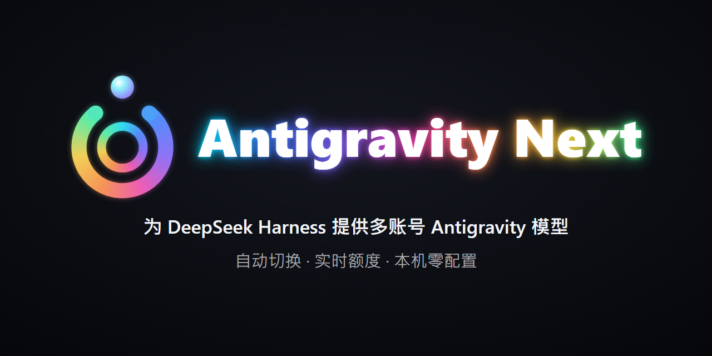
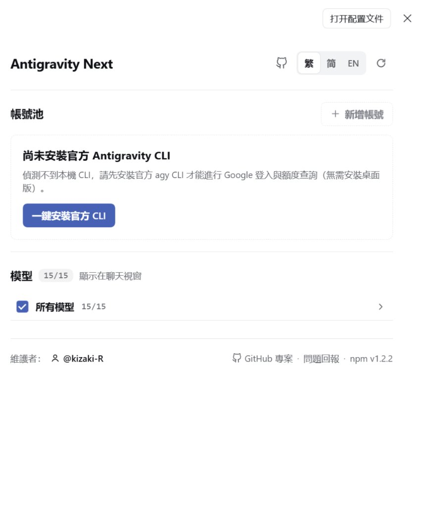
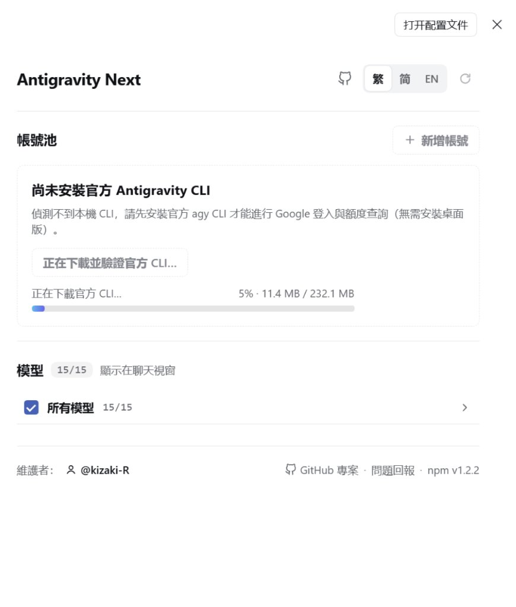
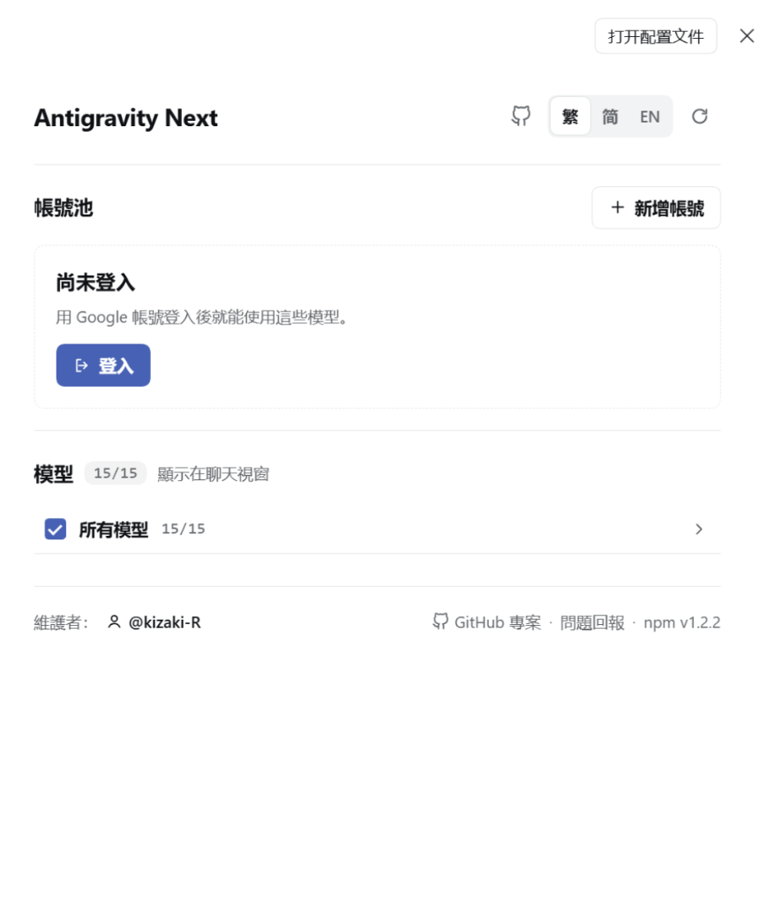

# Antigravity Next for DSH

<p align="center">
  
</p>

[](https://github.com/kizaki-R/Antigravity-Next-for-DSH/actions/workflows/ci.yml)
[](https://www.npmjs.com/package/agy-next)
[](LICENSE)
[](https://deepseek.com/harness/)

[English](README.md) | [繁體中文](README.zh-TW.md) | 简体中文

为 [DeepSeek Harness](https://deepseek.com/harness/)（DSH）开发的 Google Antigravity 模型提供商插件，注册标识为 `agy-next`。

自 `v2.0.0` 起，底层全面切换为 Google 官方 **Antigravity ACP（`agy acp` / `agy_acp_server`）** 协议通信，不再解析本地桌面端或 IDE 提取凭据，也不再直连 REST 接口。本机无需预先安装 Antigravity 桌面应用，在 DSH 设置页即可完成官方 CLI 安装、Google 账号登录、实时额度查看，以及工具调用与图片输入。

> **免责声明：** 本项目为非官方社区集成插件，与 Google 或 DeepSeek 均无隶属、认可或官方支持关系。所有登录授权均通过 Google 官方 Antigravity CLI 与您个人账号完成。

---

## v2.0.0 与旧版的区别

- **标准 stdio JSON-RPC ACP 引擎**：通过 `AntigravityAcpAdapter` 启动官方 `agy acp`（或 `agy_acp_server`），取代早期读取桌面版 `asar` / IDE `main.js` 提取客户端密钥的做法。
- **免预装桌面版、一键安装官方 CLI**：检测不到本机 `agy` 时，设置页提供单步安装引导，直接从 Google 官方 manifest 下载并校验 SHA-512 后存放在 `<DSH_HOME>/runtimes/agy-next`，界面实时显示百分比与 `MB / MB` 进度。
- **系统原生密钥环与实时额度**：自动读取 Windows 凭据管理器、macOS Keychain、Linux Secret Service（`gemini:antigravity`）或 `GEMINI_HOME` 令牌文件，显示登录中的 Google Email、订阅等级徽章及 5 小时／每周额度条，过期时静默续期。
- **DSH MCP 工具与审批弹窗桥接**：通过带验证令牌的本地 loopback MCP stdio bridge（`bin/acp-mcp-stdio.mjs`），将 DSH `ToolRuntime` 工具安全接入 ACP 会话，并补齐 Draft 2020-12 JSON Schema 规范与审批弹窗流程。
- **多模态图片输入与思考强度切换**：从 DSH 附件库读取图片字节并转为 ACP 图片内容块发送，按模型映射 `reasoningEffort` 至 ACP `thought_level`，对话结束后通过 `session/close` 清理会话。

---

## 设置界面预览

<table>
  <tr>
    <td align="center" width="33%">
      <br />
      <sub>1. 未检测到本机 CLI 时提示一键安装</sub>
    </td>
    <td align="center" width="33%">
      <br />
      <sub>2. 实时下载百分比与 SHA-512 校验进度</sub>
    </td>
    <td align="center" width="33%">
      <br />
      <sub>3. CLI 就绪后直接进行 Google 登录</sub>
    </td>
  </tr>
</table>

---

## 环境要求

- **Node.js**：`>= 20`
- **DeepSeek Harness**：`0.1.5-rc.1` ～ `0.2.x`
- **支持平台**：Windows、macOS、Linux（`x64` / `arm64`，含 Linux musl 检测）
- **Google 账号**：支持浏览器 OAuth 授权并具备 Antigravity 使用资格的个人账号

---

## 安装方式

### 方式一：DSH 插件市场（推荐）

1. 打开 DSH 侧边栏的 **「插件」→「插件市场」**。
2. 搜索 `agy-next` 或 `antigravity`。
3. 点击 **「安装」**，完成后重载或重启 DSH。

### 方式二：npm 命令行安装

在 DSH profile 目录下执行：

```bash
cd ~/.dsh/profiles/desktop
npm install agy-next@2.0.0
```

### 方式三：本地开发链接

```bash
dsh plugin --profile <profile> add link:/absolute/path/to/agy-next
```

---

## 快速上手

1. 打开 DSH 的 **「设置」→「AGY-Next」**。
2. 若界面提示尚未安装官方 CLI，点击 **「一键安装官方 CLI」**，等待下载与 SHA-512 校验完成。
3. 点击 **「登录」**，在浏览器完成 Google 账号授权。
4. 确认账号 Email、订阅方案与剩余额度显示后，即可在对话窗口选用 `Antigravity Next` 下的各模型。

> 若您从 `v1.x` 升级而来，旧版架构签发的令牌无法在 ACP 下续期，升级后请在 **「设置」→「AGY-Next」** 重新登录一次 Google 账号。

也可在 `agy-next/` 目录下使用 CLI 辅助命令：

```bash
npm run login -- --check-install   # 检查本机 ACP CLI 状态
npm run login                      # 必要时自动安装 CLI 并发起 Google 登录
npm run login -- --status          # 查看登录状态、账号 Email 与令牌来源
npm run login -- --force           # 强制重新进行 Google 授权
npm run login -- --logout          # 登出 Antigravity ACP 账号
```

详细说明与排障指南请参阅 [SETUP.md](SETUP.md)。

---

## 可执行文件搜索顺序与配置说明

`resolveAcpLaunch()` 按以下顺序查找可用的 ACP 可执行文件（命中即止）：

1. 环境变量 `AGY_NEXT_ACP_BIN` 指定的可执行文件路径
2. `PATH` 中的 `agy`（以 `agy acp` 启动）
3. `PATH` 中的 `agy_acp_server`
4. 各操作系统常见用户安装目录（Windows：`%LOCALAPPDATA%\agy\bin\agy.exe`；macOS / Linux：`~/.local/bin/agy`、`~/.local/bin/antigravity`、`~/.agy/bin/agy`）
5. 插件通过一键安装存放在 `<DSH_HOME>/runtimes/agy-next` 的托管 CLI

有效配置项（`cordis.yml` / 环境变量）：

| 配置键名 | 环境变量 | 说明 |
|---|---|---|
| `credentialPath` | `AGY_NEXT_CREDENTIAL_PATH` | 指定账号元数据与模型可见性配置路径（默认 `<DSH_HOME>/storages/agy-next-oauth.json`） |
| — | `AGY_NEXT_ACP_BIN` | 手动指定自定义 `agy` 可执行文件完整路径 |

旧版 `v1.x` 桌面端架构参数（`clientSource`、`discoveryTimeoutMs`、`projectCacheTtlMs`、`clientId`、`clientSecret`、`clientPath`、`AGY_NEXT_INSTALL_PATH`）已于 `v2.0.0` 退场，不再影响运行与登录流程。

---

## 支持模型清单

内置默认模型列表如下，并在连接 ACP server 时随账号返回动态更新：

| 模型家族 | 代表型号 | 上下文长度 | 特性说明 |
|---|---|---|---|
| **Gemini 4 Argon** | `gemini-4-argon` | 1M tokens | 支持 `low` / `medium` / `high` 思考档位、多模态图片输入 |
| **Gemini 3 / 2.5** | `gemini-3.8-flash`、`gemini-3-flash`、`gemini-3.1-flash-lite`、`gemini-2.5-pro`、`gemini-2.5-flash` | 1M tokens | 支持多模态图片输入与 MCP 工具桥接 |
| **Claude 系列** | `claude-sonnet-5-5`、`claude-opus-5-5`、`claude-opus-4-6`、`claude-sonnet-4-6` | 250k ～ 1M tokens | 通过 Antigravity ACP 运行，支持思考强度配置 |
| **开源大模型** | `gpt-oss-120b` | 128k tokens | 通过 Antigravity ACP 提供推理 |

---

## 开发与离线验证

在 `agy-next/` 目录下执行：

```bash
npm run check          # 检查全部 55 个模块语法与界面版本校验
npm test               # 运行 10 组离线回归与 ACP 测试套件
npm run test:peers     # 配合宿主 peer 依赖运行集成测试
npm run verify:peers   # 运行跨版本 peer 离线契约检查
```

运行 peer 契约测试时，请指定宿主 `node_modules` 路径：

```powershell
$env:AGY_PEER_ROOT = 'C:\path\to\dsh\node_modules'
npm run test:peers
```

---

## 安全与隐私边界

- **不内置客户端密钥**：源码与发布包不包含任何 Google OAuth Client ID 或 Client Secret。
- **凭据由系统管理**：Google OAuth 授权由官方 `agy` 写入系统密钥环（`gemini:antigravity`）或 `GEMINI_HOME` 令牌文件，插件不私自复制密码。
- **脱敏诊断报告**：`GET /agy-next/api/diagnostics` 仅输出 ACP 可达性、协议版本与启动来源等状态字段，不含任何 Token 或本机个人目录路径。

---

## 开源协议

本项目基于 [MIT](LICENSE) 协议开源 © [Kizaki](https://github.com/kizaki-R)
