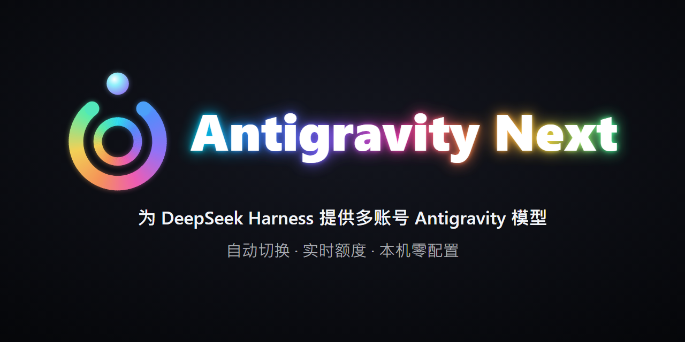

# Antigravity Next for DSH

<p align="center">
  
</p>

[](https://github.com/kizaki-R/Antigravity-Next-for-DSH/actions/workflows/ci.yml)
[](package.json)
[](LICENSE)
[](https://deepseek.com/harness/)

[English](README.md) | [繁體中文](README.zh-TW.md) | [简体中文](README.zh-CN.md)

非官方的 [DeepSeek Harness](https://deepseek.com/harness/)（DSH）模型提供商插件。将本地安装的官方 Google Antigravity / Cloud Code Assist 模型集成至 DSH 的 Agent 核心循环中，提供商标识为 `agy-next`。

> **免责声明：** 本项目为非官方本地集成，与 Google 或 DeepSeek 均无任何隶属、认可或官方支持关系。使用前请确保拥有合法 Google 账号授权，且本机已安装官方 Antigravity 应用程序。

---

## 核心特性

- **零云端配置：** 自动从本机已安装的官方 Antigravity 桌面应用中解析 OAuth 客户端凭据，无需在 Google Cloud Console 手动创建项目或金钥。
- **多账号轮换池：** 支持登录多个 Google 账号，配置额度安全阈值，在当前账号额度耗尽时自动无缝故障转移至备用账号。
- **可视化额度仪表盘：** 设置页面实时展示 Gemini、Claude 3p 及 Gemini 4 Argon 每周/5小时配额监控条。
- **思考强度控制：** 原生支持 Gemini 4 Argon 推理思考强度调节（Low / Medium / High）。
- **隐私与本地优先：** 客户端解析全程只读。Token 仅保存在本地 `<DSH_HOME>/storages/agy-next-oauth.json`，绝不上传私钥或账号数据。

---

## 环境要求

1. **DeepSeek Harness：** 版本 `>=0.1.5-rc.1 <0.3.0`，Node.js 运行时 `>=20`。
2. **官方 Antigravity 桌面端：** 安装于本机 Windows 系统（macOS / Linux 适配进行中）。请从[官方渠道](https://antigravity.google/product/antigravity-2)下载。*运行时无需保持该应用程序处于开启状态。*
3. **Google 账号：** 支持浏览器 OAuth 授权且具备访问 Gemini / Cloud Code Assist 服务的权限。

---

## 安装说明

### 方式一：通过 DSH 桌面端或 Web 界面安装（推荐）

1. 在 DSH 侧边栏打开 **“插件” → “+ 添加插件”**。
2. 在输入框中输入 GitHub 仓库地址：
   ```text
   https://github.com/kizaki-R/Antigravity-Next-for-DSH
   ```
   *（npm 发布后，亦可直接输入包名 `agy-next`）。*
3. 点击 **“安装”**，DSH 将自动挂载插件并注册设置界面。
4. 重启 DSH。

### 方式二：本地开发模式（CLI / Developer Link）

本地开发时添加链接至配置：

```bash
# 在 DSH profile 中注册本地链接
dsh plugin --profile <profile> add link:/absolute/path/to/agy-next
```

确保该 profile 的 `dsh.profile.bundles` 中包含 `agy-next`，随后重启 DSH。

---

## 快速使用

### 1. 验证与登录

在 DSH 中进入 **“设置” → “AGY-Next”**：

1. **安装状态：** 确认插件成功检测到本地 Antigravity 的安装路径。
2. **账号登录：** 点击 **“登录 / 添加账号”**，系统将调用浏览器打开 Google 官方授权页。
3. 授权成功后，账号将添加至账号池，并实时展示各模型配额状态。

*CLI 命令行备用命令：*

```bash
npm run login           # 登录或添加账号
npm run login -- --status  # 查看当前活动账号状态与额度
npm run login -- --force   # 强制重新认证
npm run login -- --logout  # 清除已保存的凭据
```

### 2. 自定义安装路径

若 Antigravity 安装在非标准目录，可在启动 DSH 前配置环境变量：

```powershell
# PowerShell
$env:AGY_NEXT_INSTALL_PATH = 'C:\Custom\Path\To\Antigravity'
```

---

## 进阶配置

如需调整参数，可编辑 profile 目录下的 `cordis.yml`：

```yaml
- id: agy-next
  name: agy-next
  config:
    credentialPath: ""               # 默认为 <DSH_HOME>/storages/agy-next-oauth.json
    streamIdleTimeoutMs: 300000      # 5 分钟空闲流保护超时
    discoveryTimeoutMs: 8000         # 本地二进制客户端探测超时
    projectCacheTtlMs: 1800000       # 项目元数据缓存生存期（30 分钟）
    runtimeModel: ""                 # 可选：固定指定后端模型 ID
```

---

## 支持模型列表

| 模型系列 | 代表型号 | 上下文长度 | 特性支持 |
|---|---|---|---|
| **Gemini 4 Argon** | `gemini-4-argon` | 1M tokens | Low / Medium / High 思考档位，5 小时与每周额度独立统计 |
| **Gemini 3 / 2.5** | `gemini-3.8-flash`、`gemini-3-flash`、`gemini-2.5-pro`、`gemini-2.5-flash` | 1M tokens | 高速多模态流式交互，工具调用 |
| **Claude 系列** | `claude-sonnet-5-5`、`claude-opus-5-5`、`claude-opus-4-6`、`claude-sonnet-4-6` | 1M tokens | 深度集成 Cloud Code Assist 的 Claude 运行时 |
| **开源模型** | `gpt-oss-120b` | 128k tokens | 大参数开源权重推理 |

---

## 开发与测试

在 `agy-next/` 目录下运行完整离线测试集：

```bash
npm run check        # 检查全量 39 个源码模块的语法
npm test             # 离线回归测试集（21 个用例）
npm run test:peers   # 严格主控 peers 契约测试（不允许跳过）
```

进行 peers 契约测试前配置主控依赖路径：

```powershell
$env:AGY_PEER_ROOT = 'C:\path\to\dsh\node_modules'
npm run test:peers
```

---

## 安全与架构机制

- **零密钥内嵌：** 源码完全不包含任何硬编码的 Google Client ID 或 Secret，全部运行时由本地应用解析。
- **存储隔离：** 凭据统一存储在 DSH 专属的 `agy-next-oauth.json` 中，绝不触碰官方应用的本地数据库。
- **墓碑机制（Tombstone）：** 登出时写入标有 `loggedOut: true` 的空文件，彻底杜绝历史配置残留导致的幽灵账号自动复活问题。

---

## 开源协议

本项目基于 [MIT](LICENSE) 协议开源 © [Kizaki](https://github.com/kizaki-R)
