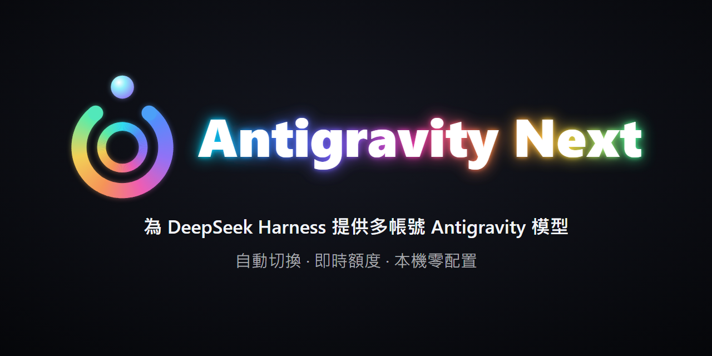
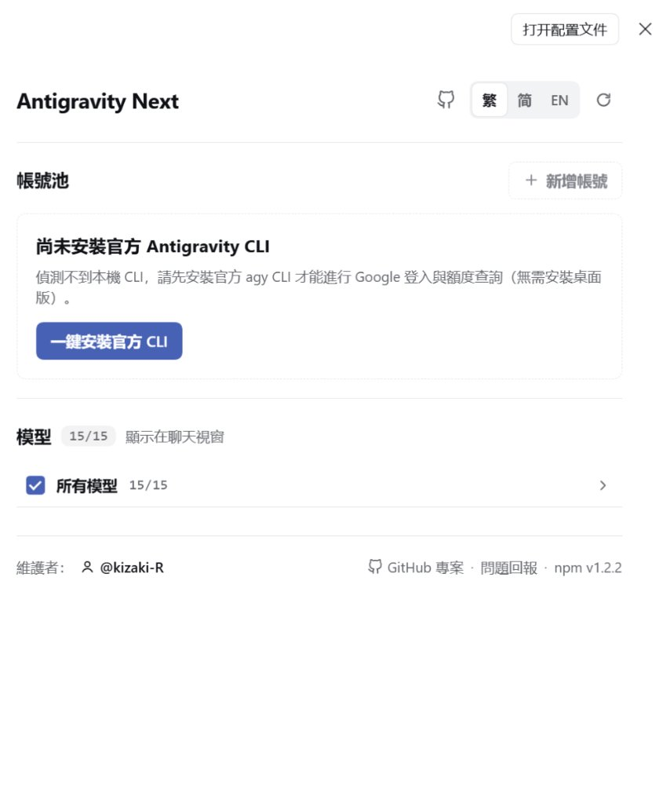
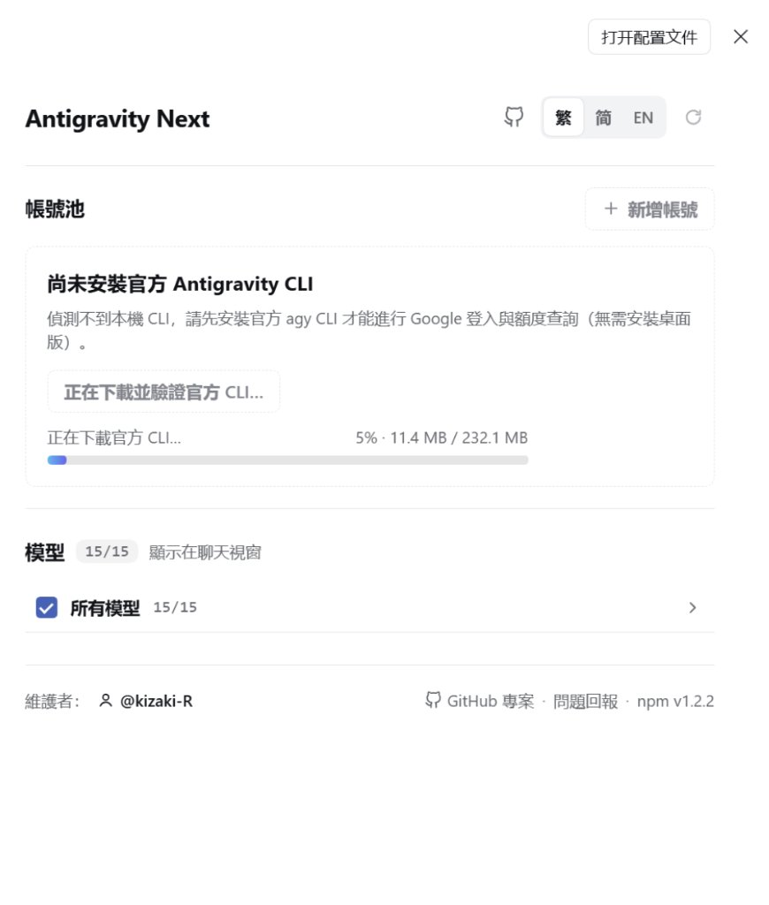
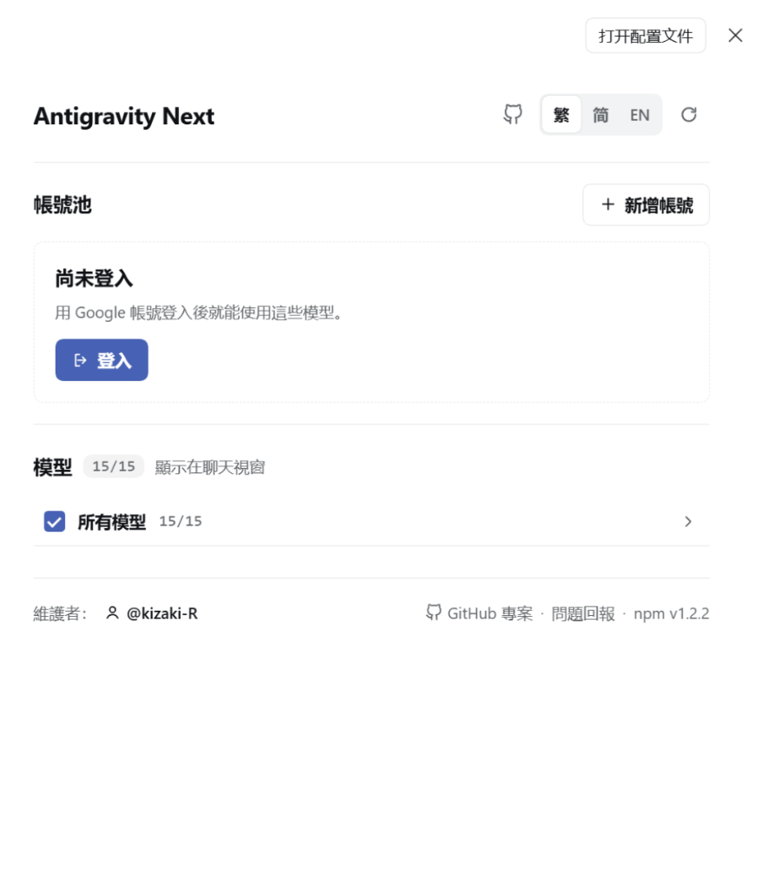

# Antigravity Next for DSH

<p align="center">
  
</p>

[](https://github.com/kizaki-R/Antigravity-Next-for-DSH/actions/workflows/ci.yml)
[](https://www.npmjs.com/package/agy-next)
[](LICENSE)
[](https://deepseek.com/harness/)

[English](README.md) | 繁體中文 | [简体中文](README.zh-CN.md)

為 [DeepSeek Harness](https://deepseek.com/harness/)（DSH）打造的 Google Antigravity 模型供應商外掛，註冊識別碼為 `agy-next`。

自 `v2.0.0` 起，底層全面切換為 Google 官方 **Antigravity ACP（`agy acp` / `agy_acp_server`）** 協議通訊，不再依賴拆解桌面版或 IDE 提取憑證，也不直連 REST 端點。本機不需預先安裝 Antigravity 桌面版應用程式，直接在 DSH 設定頁就能安裝官方 CLI、完成 Google 登入、檢視即時額度，並在對話中呼叫 DSH 工具與傳送圖片。

> **免責聲明：** 本專案為非官方社群整合外掛，與 Google 或 DeepSeek 無任何隸屬、認可或官方支援關係。所有登入授權均透過 Google 官方 Antigravity CLI 與您個人帳號完成。

---

## v2.0.0 與舊版的差異

- **標準 stdio JSON-RPC ACP 引擎**：透過 `AntigravityAcpAdapter` 啟動官方 `agy acp`（或 `agy_acp_server`），取代早期讀取桌面版 `asar` / IDE `main.js` 抽取用戶端金鑰的作法。
- **免預裝桌面版、一鍵安裝官方 CLI**：偵測不到本機 `agy` 時，設定頁會提示單步驟安裝，直接從 Google 官方 manifest 下載並驗證 SHA-512 雜湊後存放至 `<DSH_HOME>/runtimes/agy-next`，畫面即時顯示百分比與 `MB / MB` 進度。
- **系統原生金鑰圈與即時額度**：自動讀取 Windows 認證管理員、macOS Keychain、Linux Secret Service（`gemini:antigravity`）或 `GEMINI_HOME` 權杖檔，顯示登入中的 Google Email、訂閱方案徽章與 5 小時／每週額度條，過期時靜默續期。
- **DSH MCP 工具與核准彈窗橋接**：透過帶認證權杖的本機 loopback MCP stdio bridge（`bin/acp-mcp-stdio.mjs`），將 DSH `ToolRuntime` 工具安全接入 ACP 工作階段，並補齊 Draft 2020-12 JSON Schema 規範與核准彈窗流程。
- **多模態圖片輸入與思考強度切換**：透過 DSH 附件庫讀取圖片位元組並轉送為 ACP 圖片區塊，依模型對應 `reasoningEffort` 至 ACP `thought_level`，輪次結束後透過 `session/close` 清理工作階段。

---

## 設定介面預覽

<table>
  <tr>
    <td align="center" width="33%">
      <br />
      <sub>1. 未偵測到本機 CLI 時顯示一鍵安裝引導</sub>
    </td>
    <td align="center" width="33%">
      <br />
      <sub>2. 即時下載百分比與 SHA-512 校驗進度</sub>
    </td>
    <td align="center" width="33%">
      <br />
      <sub>3. CLI 就緒後即可直接進行 Google 登入</sub>
    </td>
  </tr>
</table>

---

## 系統需求

- **Node.js**：`>= 20`
- **DeepSeek Harness**：`0.1.5-rc.1` ～ `0.2.x`
- **支援平台**：Windows、macOS、Linux（`x64` / `arm64`，含 Linux musl 偵測）
- **Google 帳號**：支援瀏覽器 OAuth 授權並具 Antigravity 使用資格之個人帳號

---

## 安裝方式

### 方式一：DSH 外掛市集（推薦）

1. 開啟 DSH 側邊欄的 **「外掛」→「外掛市集」**。
2. 搜尋 `agy-next` 或 `antigravity`。
3. 點選 **「安裝」**，完成後重新載入或重啟 DSH。

### 方式二：npm 命令列安裝

於 DSH profile 目錄下執行：

```bash
cd ~/.dsh/profiles/desktop
npm install agy-next@2.0.0
```

### 方式三：本機開發連結

```bash
dsh plugin --profile <profile> add link:/absolute/path/to/agy-next
```

---

## 快速上手

1. 開啟 DSH 的 **「設定」→「AGY-Next」**。
2. 若畫面顯示尚未安裝官方 CLI，點選 **「一鍵安裝官方 CLI」**，等候下載與 SHA-512 校驗完成。
3. 點選 **「登入」**，於瀏覽器完成 Google 帳號授權。
4. 確認帳號 Email、方案等級與剩餘額度出現後，即可在對話視窗選用 `Antigravity Next` 底下各模型。

> 若您是由 `v1.x` 升級上來，舊版架構產生的權杖無法於 ACP 下沿用，升級後請在 **「設定」→「AGY-Next」** 重新登入一次 Google 帳號。

也可於 `agy-next/` 目錄下使用 CLI 輔助指令：

```bash
npm run login -- --check-install   # 檢查本機 ACP CLI 狀態
npm run login                      # 必要時自動安裝 CLI 並開啟 Google 登入
npm run login -- --status          # 檢視登入狀態、帳號 Email 與權杖來源
npm run login -- --force           # 強制重新進行 Google 授權
npm run login -- --logout          # 登出 Antigravity ACP 帳號
```

詳細說明與排錯請參閱 [SETUP.md](SETUP.md)。

---

## 執行檔搜尋順序與設定說明

`resolveAcpLaunch()` 依下列順序尋找可用的 ACP 執行檔（找到即停止）：

1. 環境變數 `AGY_NEXT_ACP_BIN` 指定的執行檔路徑
2. `PATH` 中的 `agy`（以 `agy acp` 啟動）
3. `PATH` 中的 `agy_acp_server`
4. 各作業系統常見使用者安裝目錄（Windows：`%LOCALAPPDATA%\agy\bin\agy.exe`；macOS / Linux：`~/.local/bin/agy`、`~/.local/bin/antigravity`、`~/.agy/bin/agy`）
5. 外掛透過一鍵安裝存放於 `<DSH_HOME>/runtimes/agy-next` 的託管 CLI

有效設定欄位（`cordis.yml` / 環境變數）：

| 設定欄位 | 環境變數 | 說明 |
|---|---|---|
| `credentialPath` | `AGY_NEXT_CREDENTIAL_PATH` | 指定帳號中繼資料與顯示設定儲存路徑（預設 `<DSH_HOME>/storages/agy-next-oauth.json`） |
| — | `AGY_NEXT_ACP_BIN` | 手動指定自訂 `agy` 執行檔完整路徑 |

舊版 `v1.x` 桌面版架構欄位（`clientSource`、`discoveryTimeoutMs`、`projectCacheTtlMs`、`clientId`、`clientSecret`、`clientPath`、`AGY_NEXT_INSTALL_PATH`）已於 `v2.0.0` 退場並不再影響執行流程。

---

## 支援模型清單

內建預設清單如下，並會在連線 ACP server 時依帳號回報動態更新：

| 模型家族 | 代表型號 | 上下文長度 | 特性說明 |
|---|---|---|---|
| **Gemini 4 Argon** | `gemini-4-argon` | 1M tokens | 支援 `low` / `medium` / `high` 思考強度、多模態圖片輸入 |
| **Gemini 3 / 2.5** | `gemini-3.8-flash`、`gemini-3-flash`、`gemini-3.1-flash-lite`、`gemini-2.5-pro`、`gemini-2.5-flash` | 1M tokens | 支援多模態圖片輸入與 MCP 工具橋接 |
| **Claude 系列** | `claude-sonnet-5-5`、`claude-opus-5-5`、`claude-opus-4-6`、`claude-sonnet-4-6` | 250k ～ 1M tokens | 透過 Antigravity ACP 執行，支援思考強度設定 |
| **開源大模型** | `gpt-oss-120b` | 128k tokens | 透過 Antigravity ACP 提供推理 |

---

## 開發與離線驗證

於 `agy-next/` 目錄下執行：

```bash
npm run check          # 檢查全部 55 個模組語法與介面版本防呆
npm test               # 執行 10 組離線回歸與 ACP 測試套件
npm run test:peers     # 搭配宿主 peer 相依套件執行整合測試
npm run verify:peers   # 執行跨版本 peer 離線合約驗證
```

執行 peer 契約測試時，請指定宿主 `node_modules` 路徑：

```powershell
$env:AGY_PEER_ROOT = 'C:\path\to\dsh\node_modules'
npm run test:peers
```

---

## 安全與隱私邊界

- **不內嵌用戶端密鑰**：原始碼與套件不包含任何 Google OAuth Client ID 或 Client Secret。
- **憑證由系統管理**：Google OAuth 授權由官方 `agy` 寫入作業系統金鑰圈（`gemini:antigravity`）或 `GEMINI_HOME` 權杖檔，外掛不私自備份密碼。
- **零洩漏診斷報告**：`GET /agy-next/api/diagnostics` 僅輸出 ACP 可達性、協議版本與啟動來源等狀態欄位，絕不含 Token 或本機個人目錄路徑。

---

## 授權條款

本專案採用 [MIT](LICENSE) 條款開源 © [Kizaki](https://github.com/kizaki-R)
