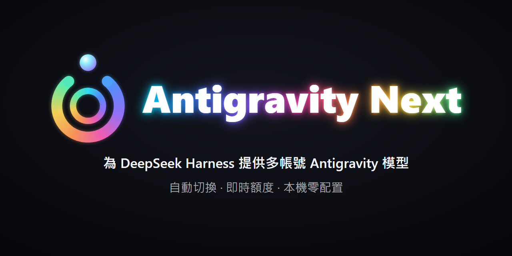

# Antigravity Next for DSH

<p align="center">
  
</p>

[](https://github.com/kizaki-R/Antigravity-Next-for-DSH/actions/workflows/ci.yml)
[](https://www.npmjs.com/package/agy-next)
[](LICENSE)
[](https://deepseek.com/harness/)

[English](README.md) | [繁體中文](README.zh-TW.md) | [简体中文](README.zh-CN.md)

非官方的 [DeepSeek Harness](https://deepseek.com/harness/)（DSH）模型供應商外掛。將本機安裝的官方 Google Antigravity / Cloud Code Assist 整合至 DSH 的 Agent 核心架構中，註冊提供者識別碼為 `agy-next`。

> **免責聲明：** 本專案為非官方本地整合，與 Google 或 DeepSeek 均無任何隸屬、認可或官方支援關係。使用者須具備合法 Google 帳號授權，並於本機安裝官方 Antigravity 應用程式。

---

## 功能特點

- **免手動配置 GCP**：直接從本機安裝的官方 Antigravity 桌面程式或 Antigravity IDE 解析 OAuth client，無需於 Google Cloud Console 建立專案或金鑰。
- **雙架構與 IDE 支援**：同時支援官方桌面版（Electron ASAR）與 Antigravity IDE（VS Code 分支），具備自動降級容錯與獨立設定能力。
- **智慧路徑與捷徑穿透**：設定頁支援貼上任意安裝目錄、執行檔（`Antigravity.exe` / `Antigravity IDE.exe`）、內部目錄（`resources/app`）或 Windows 開始功能表 `.lnk` 捷徑，系統自動向上收斂鎖定正規安裝根目錄。
- **多帳號輪替池**：可加入多組 Google 帳號並設定安全閾值；當前帳號額度用盡時，自動切換至備用帳號接續對話。
- **即時額度監控面板**：在設定頁顯示 Gemini、Claude 與 Gemini 4 Argon 的每週及 5 小時額度條與重設倒數。
- **思考強度檔位調節**：支援推理思考強度（Low、Medium、High，適用於 Gemini 4 Argon、Gemini 3.8 Flash 與 Claude 系列）。
- **本機安全儲存**：客戶端探索僅讀取檔案，不執行官方 App。Token 僅存於本機 `<DSH_HOME>/storages/agy-next-oauth.json`，不上傳任何金鑰。

---

## 系統需求

1. **DeepSeek Harness**：版本 `0.1.5` ～ `0.2.x`（完整相容至最新 `0.2.1` 系列），Node.js `>=20`。
2. **官方 Antigravity 安裝**：本機已安裝官方桌面應用程式或 Antigravity IDE（支援 Windows、macOS，Linux 支援進行中；*使用外掛時該程式不需保持啟動*）。
3. **Google 帳號**：可正常完成瀏覽器 OAuth 授權，並擁有 Gemini / Cloud Code Assist 存取權限。

---

## 安裝指南

### 方式一：DSH 插件市場安裝（推薦）

1. 開啟 DSH 側邊欄的 **「插件」→「插件市場」**。
2. 搜尋 `agy-next` 或 `antigravity`。
3. 點選 **「安裝」**，完成後重新啟動 DSH。

### 方式二：終端機命令列安裝

在 DSH 桌面 profile 目錄下直接安裝：

```bash
cd ~/.dsh/profiles/desktop
npm install agy-next@latest
```

### 方式三：本機開發模式（CLI / Link）

從本地原始碼進行開發測試：

```bash
dsh plugin --profile <profile> add link:/absolute/path/to/agy-next
```

---

## 快速上手

### 1. 帳號設定

在 DSH 中開啟 **「設定」→「AGY-Next」**：

1. **檢查狀態**：確認頁面偵測到本機 Antigravity 桌面版或 IDE。
2. **自訂路徑（可選）**：若安裝於自訂目錄，在「自訂安裝路徑」欄位貼上資料夾、可執行檔或開始功能表捷徑，點擊 **「檢查」** ➔ **「儲存」**。
3. **新增帳號**：點選 **「登入 / 新增帳號」**，瀏覽器會開啟 Google 官方授權頁面。
4. 授權後帳號即進入帳號池，並顯示各模型即時額度進度條。

*CLI 備用指令：*

```bash
npm run login              # 登入新帳號
npm run login -- --status  # 檢視目前作用帳號與額度
npm run login -- --force   # 強制重新授權
npm run login -- --logout  # 清除已存憑證
```

---

## 進階設定

可於 profile 的 `cordis.yml` 中微調參數：

```yaml
- id: agy-next
  name: agy-next
  config:
    clientSource: "auto"             # "auto" (預設，桌面版優先且支援 IDE 容錯降級)、"desktop" 或 "ide"
    credentialPath: ""               # 預設：<DSH_HOME>/storages/agy-next-oauth.json
    streamIdleTimeoutMs: 300000      # 串流閒置超時防護（毫秒，預設 5 分鐘）
    discoveryTimeoutMs: 8000         # 本機客戶端探測超時（毫秒）
    projectCacheTtlMs: 1800000       # 專案中繼資料快取 TTL（毫秒，30 分鐘）
    runtimeModel: ""                 # 可選：強制指定特定後端模型 ID
```

---

## 支援模型矩陣

| 模型家族 | 代表型號 | 上下文長度 | 特性支援 |
|---|---|---|---|
| **Gemini 4 Argon** | `gemini-4-argon` | 1M tokens | Low / Medium / High 思考檔位、5 小時與每週額度獨立監控 |
| **Gemini 3 / 2.5** | `gemini-3.8-flash`、`gemini-3-flash`、`gemini-2.5-pro`、`gemini-2.5-flash` | 1M tokens | 高速多模態串流輸出、工具調用 |
| **Claude 系列** | `claude-sonnet-5-5`、`claude-opus-5-5`、`claude-opus-4-6`、`claude-sonnet-4-6` | 1M tokens | 整合 Cloud Code Assist 之 Claude 執行環境 |
| **開源大模型** | `gpt-oss-120b` | 128k tokens | 大參數開源權重推理 |

---

## 開發與測試

於 `agy-next/` 目錄下執行離線測試：

```bash
npm run check          # 檢查全數 43 支模組語法
npm test               # 執行離線回歸測試（36 項 fixture 隔離驗證）
npm run test:peers     # 嚴格主機 peers 契約測試（需設定 AGY_PEER_ROOT）
npm run verify:peers   # 對真實 peers 驗證主機契約
```

執行 peers 契約測試時，指定主機依賴路徑：

```powershell
$env:AGY_PEER_ROOT = 'C:\path\to\dsh\node_modules'
npm run test:peers
```

---

## 安全設計

- **不內嵌密鑰**：代碼庫不包含任何 Google Client ID 或 Client Secret，全部由本機應用程式資源即時解析。
- **儲存隔離**：憑證儲存在 DSH 專屬的 `agy-next-oauth.json`，不讀取或更動官方 Antigravity 的內部資料庫。
- **墓碑機制（Tombstone）**：登出所有帳號時寫入標記為 `loggedOut: true` 的空清冊，防止舊版設定自動回補舊帳號。

---

## 授權條款

本專案採用 [MIT](LICENSE) 條款開源 © [Kizaki](https://github.com/kizaki-R)
